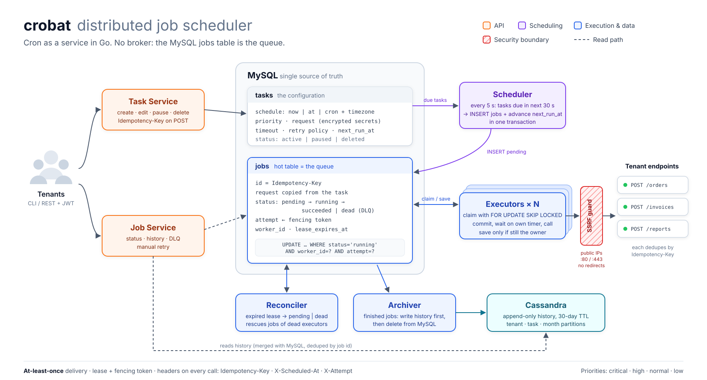

# crobat

**Cron as a service, written in Go.** You tell it to call your endpoint now, at a date, or on a cron expression, and it does, with priorities, retries, a dead letter queue, and a history of every run.

And it has **no queue**. No Kafka, no RabbitMQ, no Redis. The queue is a MySQL table.

[](go.mod)
[](deploy/mysql/schema.sql)
[](internal/adapter/cassandra/cassandra.go)
[](LICENSE)



---

## Why no broker?

Saving a job in a database and then publishing it to a broker is a **dual write**. If one of the two fails, they disagree forever. With one table there is only one write.

- **Executors claim jobs with `SELECT ... FOR UPDATE SKIP LOCKED`.** Each executor skips the rows another one already locked, so nobody waits.
- **The lease lives in the job's row**, not in Redis. There is one source of truth.
- **Every claim bumps an attempt counter** that works as a fencing token. If an old executor comes back late with a result, the counter no longer matches and its write touches 0 rows.
- **Nothing gets lost**, because a job is saved before it ever runs.

## Features

- **Schedules:** run now, at a date and time, or on a cron expression (any IANA timezone)
- **Priorities:** `critical`, `high`, `normal`, `low`. Critical never waits behind low, and low never starves.
- **Retries** with exponential backoff, then a **DLQ** with manual retry
- **Status and history** of every execution: recent runs from MySQL, older runs from Cassandra (30-day TTL)
- **At-least-once delivery** with a stable `Idempotency-Key` on every attempt, plus `X-Scheduled-At` and `X-Attempt` headers
- **Multi-tenant:** the tenant comes from the JWT, and each tenant gets a fair share of executor capacity
- **Secrets** (request headers and body) encrypted with AES-256-GCM, and never logged or archived
- **SSRF protection** in the dialer, after DNS resolution: only public IPs on ports 80/443, no proxy, no redirects
- **Idempotent task creation** via the `Idempotency-Key` header

## Measured, not promised

The defining peak of a cron platform is everyone scheduling on the hour. [LOADTESTING.md](LOADTESTING.md) reproduces it with k6: **30,000 jobs due in the same second**, spread across four tenants and all four priorities.

| | Result on one laptop (Docker Desktop) |
|---|---|
| Peak drained | **11–24 s**, at 1,250–2,400 jobs/s |
| Lost / stuck / duplicated jobs | **0 / 0 / 0** |
| p99 lag: high · normal · low | **2.4–5.4 s · 8.3–16.1 s · 11.2–23.9 s** (targets: 20 s · minutes · 20 min) |
| p99 lag: critical | **0.85–1.56 s** (target 1 s: right at the edge; the next steps are documented) |
| Tenant fairness | Every tenant within 5 % of the others, while one tenant sent 70 % of the load |
| Task API | 1,000 creates/s at p99 < 400 ms, saturating around 2,570/s, 0 errors |

The load tests found and fixed an executor throughput cap and a deadlock that could cost a duplicate call. LOADTESTING.md describes both.

## Quick start

Requirements: Docker (with Compose v2) and Go 1.25+.

```bash
cp .env.example .env                 # dev secrets; generate real ones for anything shared
docker compose up -d --build         # MySQL, Cassandra, 6 services, a demo endpoint
go build -o bin/crobat ./cmd/crobat  # the CLI

set -a; source .env; set +a
export CROBAT_TOKEN=$(bin/crobat token acme)   # a dev JWT for tenant "acme"
```

Cassandra takes about a minute to become healthy on the first start.

## Usage

```bash
# Run now, with a secret header (encrypted at rest, never returned)
bin/crobat task create -name hello -url http://echo/hello -priority critical \
  -header "Authorization: Bearer xyz" -idempotency-key hello-1

# Every day at 09:00 Madrid time
bin/crobat task create -name daily-report -url http://echo/report \
  -cron "0 9 * * *" -tz Europe/Madrid -priority high

# Once, at a given time
bin/crobat task create -name reminder -url http://echo/remind -at 2026-12-24T18:00:00Z

# A flaky endpoint (succeeds on attempt 2) and a broken one (ends up in the DLQ)
bin/crobat task create -name flaky  -url http://echo/flaky -backoff-ms 500
bin/crobat task create -name doomed -url http://echo/fail  -max-attempts 2

bin/crobat task list
bin/crobat job history <task-id>
bin/crobat job dlq
bin/crobat job retry <job-id>
bin/crobat task pause|resume|delete <task-id>
```

`http://echo/...` is a demo endpoint that ships with the stack. Watch it receive calls with `docker compose logs -f echo`.

The same operations are available over REST: `task-api` on `:8080`, `job-api` on `:8081`. See [ARCHITECTURE.md § Running locally](ARCHITECTURE.md#8-running-locally).

## Services

Crobat runs as six services. Each one is a hexagon: it depends only on the ports in [internal/app/ports.go](internal/app/ports.go), and the adapters in [internal/adapter/](internal/adapter/) plug MySQL, Cassandra, and HTTP into those ports. Each service folder has its own README with its API or loop, guarantees, configuration, and scaling notes.

| Service | Objective | Folder | Run as |
|---|---|---|---|
| **Task Service** | Let tenants create, edit, pause, resume, and delete tasks, stored durably in MySQL | [internal/services/taskservice/](internal/services/taskservice/) | `crobat serve task-api` · `:8080` |
| **Scheduler** | Turn tasks due in the next 30 s into pending jobs, in one transaction, every 5 s | [internal/services/scheduler/](internal/services/scheduler/) | `crobat serve scheduler` |
| **Executor** | Claim jobs with `SKIP LOCKED`, fire each on its own timer, call the endpoint, save the result under a fencing guard | [internal/services/executor/](internal/services/executor/) | `crobat serve executor` |
| **Reconciler** | Rescue jobs whose executor died by returning expired leases to pending (or dead) | [internal/services/reconciler/](internal/services/reconciler/) | `crobat serve reconciler` |
| **Archiver** | Move finished jobs to Cassandra first, then delete them from MySQL | [internal/services/archiver/](internal/services/archiver/) | `crobat serve archiver` |
| **Job Service** | The read side: job status, task history, DLQ, manual retry | [internal/services/jobservice/](internal/services/jobservice/) | `crobat serve job-api` · `:8081` |

A **task** is the configuration. A **job** is one execution of it, and it copies the task's request when it is planned, so editing a task never changes a run that is already scheduled.

All six ship as one binary, `crobat serve <service>`, which is also the CLI. [ARCHITECTURE.md](ARCHITECTURE.md) has the full design: data model, job lifecycle, guarantees, the SSRF defence, why MySQL and not Postgres, configuration, and known limits.

## Project layout

```
cmd/crobat/              entrypoint: service wiring + CLI
internal/domain/         tasks, jobs, priorities, state machine (no I/O)
internal/app/            ports shared by the services (TaskStore, JobStore, HistoryStore, Caller)
internal/services/       the six services, one package + README each
internal/adapter/        mysql · cassandra · caller (SSRF-safe HTTP) · httpapi (REST + JWT)
deploy/mysql/schema.sql  tables and indexes
loadtest/                k6 peak test + lag report
```

## Development

```bash
go test -race ./...        # unit tests: every package, nothing to run first

# + integration tests against the running stack (own test database and keyspace)
set -a; source .env; set +a
MYSQL_TEST_DSN="root:$MYSQL_ROOT_PASSWORD@tcp(localhost:3306)/crobat_test" \
CASSANDRA_TEST_HOSTS=localhost go test -race ./...

loadtest/run.sh            # the 30k-in-one-second peak (stack must be running)
docker compose down -v     # stop and wipe local data
```

## Documentation

- [PRODUCT.md](PRODUCT.md): what we're building and why
- [ARCHITECTURE.md](ARCHITECTURE.md): how it is built
- [LOADTESTING.md](LOADTESTING.md): how it behaves under its defining peak

## License

[MIT](LICENSE) © 2026 Alan Rojas
